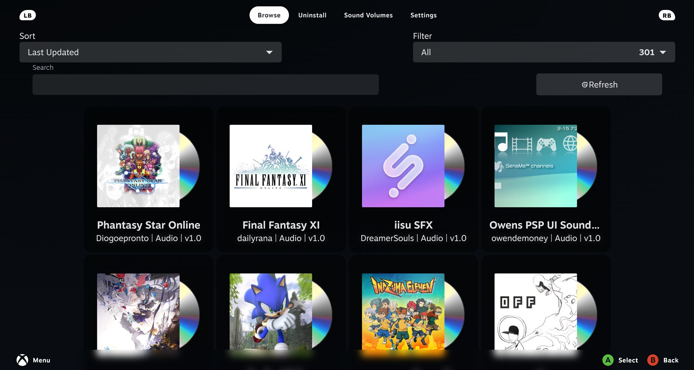
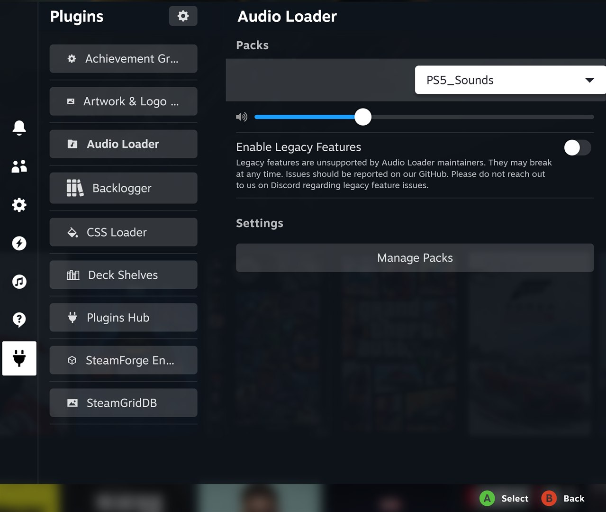

 

<h1 align="center"> Audio Loader plugin for Millennium | UnOfficial </h1>

Make Steam sound the way you want. Swap its UI sounds for one of hundreds of community sound packs from DeckThemes, from console menus to your favorite games, and fine-tune the volume of the whole pack or of every single sound, all without leaving Big Picture or the Steam desktop.

 

## Features
- Replace Steam's UI sounds with a sound pack from [DeckThemes](https://deckthemes.com).
- Browse, search, filter and sort packs in the Pack Manager, and install, update or remove them.
- Star packs with your DeckThemes account.
- Set the volume of the whole pack.
- Set the volume of each UI sound separately with [Sound Volumes](#sound-volumes).
- Packs from the Decky plugin work as they are.
- Works in Big Picture and on the Steam desktop.

## Usage
- **Steam desktop:** open Millennium's sidebar and select **Audio Loader**. The Pack Manager opens in its own window.
- **Big Picture:** the panel is in the Quick Access menu through the optional [Plugins Hub](https://github.com/DevsNate/PluginsHub-Millennium) plugin. Your selected pack plays without it.

The panel has the pack picker and its volume slider. **Manage Packs** opens the Pack Manager: Browse, Uninstall, Sound Volumes and Settings, where you can log in to your DeckThemes account.

A pack replaces Steam's own UI sounds; sounds Steam loads from the web, such as chat notifications, stay as they are.

## Packs from your Steam Deck
Packs live in `%USERPROFILE%\homebrew\sounds`, the same folder and the same format as the Decky plugin. Packs from a Steam Deck can be copied over as they are. To make your own pack, see the [DeckThemes documentation](https://docs.deckthemes.com/#/AudioLoader/README).

## Sound Volumes
Some packs have a sound or two that's louder than the rest. The **Sound Volumes** tab in the Pack Manager lists every Steam UI sound with its own slider, from 0 to 100%, so you can turn down just that one, or mute it. It works with any pack, including Steam's default sounds, and **Reset All to 100%** puts every sound back.

## Menu music
Menu music is a legacy feature that DeckThemes stopped supporting in 2024. It's still there behind **Enable Legacy Features** in the panel, off by default, but it may not work on the Steam desktop or during startup videos.

> [!NOTE]
> This is an **<ins>unofficial</ins>** port of [DeckThemes' Audio Loader for Decky Loader](https://github.com/DeckThemes/SDH-AudioLoader), adapted to run on Windows in Steam's Big Picture and Desktop mode through [Millennium](https://steambrew.app). All credit for the plugin goes to DeckThemes and its contributors; please report problems with this port [here](https://github.com/DevsNate/AudioLoader-Millennium/issues), not upstream.

## Installation
1. Install [Millennium](https://steambrew.app)
2. Download the latest release from [Releases](https://github.com/DevsNate/AudioLoader-Millennium/releases)
3. Copy `audioloader.star` into `Steam/millennium/plugins` (requires a Starlight-capable Millennium, verified with v3.6.2)
4. Restart Steam and enable Audio Loader in Millennium's plugin settings

## Files the plugin writes
Besides the packs you install, the plugin writes:

| File | What it holds |
|---|---|
| `homebrew\sounds\config.json` | Your selected pack and volumes |
| `homebrew\sounds\STORE` | Your DeckThemes login, in plain text |
| `steamui\sounds_custom` | A link to your packs folder, so Steam can play them. Made on start, no admin rights needed |

`homebrew` is in `%USERPROFILE%`; `steamui` is in Steam's folder.

## Building from source
See [DEVELOPMENT.md](DEVELOPMENT.md) for building, the project layout and updating from upstream.

## Credits
**Original plugin:** [DeckThemes](https://github.com/DeckThemes/SDH-AudioLoader) (EMERALD0874, Beebles, SuchMeme and contributors). Packs are by their authors on [DeckThemes](https://deckthemes.com).  
**Millennium port:** [DevsNate](https://github.com/DevsNate)

## License
[GPL-3.0-or-later](LICENSE). [The original plugin](https://github.com/DeckThemes/SDH-AudioLoader) is under the MIT license ([notice](LICENSES/SDH-AudioLoader-MIT.txt)). The libraries in `frontend/vendor/` keep their own licenses; see [its README](frontend/vendor/README.md).
